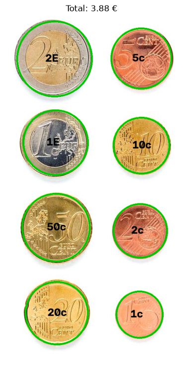

# VC_P3

## Tarea 1

La tarea cuenta con dos apartados: contar monedas a partir de la imagen ideal y tanto detectar como contar monedas en directo con una cámara web.

Se introducen las variables en u varios diccionarios para ir recolectando toda la información relevante de cara al reconocimiento y conteo del dinero

