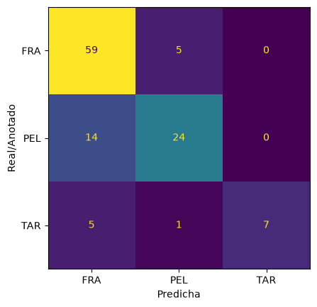

# VC_P3

## Tarea 1

La tarea cuenta con dos apartados: contar monedas a partir de la imagen ideal y tanto detectar como contar monedas en directo con una cámara web.

En primer lugar, se importa la imagen de las monedas ideal, imprimiéndola en pantalla. La siguiente celda consiste en la implementación de todas las funciones y variables necesarias para llevar a cabo. 

Existen tres diccionarios: el primero con los diámetros reales de las monedas, los cuales se usarán para, una vez obtenida la referencia de la moneda de 1€ en la imagen, poder calcular todos los diámetros de las monedas ajustando la distancia de la cámara; el segundo contiene el valor de cada moneda, imprescindible para el conteo de estas; por último, su material, el color de las monedas puede ayudar a distinguir entre las distintas monedas para no depender exclusivamente del diámetro, de esta forma según el color de la moneda se puede diferenciar mejor unas de otras.

Los círculos de la imagen (contornos externos de las monedas), se calculan con Hough en la función "detectar_circulos()". A esta se le pasa la imagen de las monedas, las convierte a escala de grises y se devuelve una lista ordenada de mayor a menor de los círculos externos de las monedas, siendo estos los diámetros.

La siguiente función, "es_moneda()" intenta calcular si el círculo detectado se trata de una moneda. Para ello obtiene un valor de diametro a partir de la escala (distancia de la imagen) para convertirlo a la "escala real" de la moneda, si el diámetro convertido se encuentra dentro del rango de los de las monedas, devuelve True.

La función "grupo_color()" busca obtener el material del que está hecha la moneda, como método de clasificación complementario al diámetro, para ello obtiene el color de cada moneda y según su valor devuelve un material u otro.

Pasando con "clasificar()", esta función ya busca obtener el valor de la moneda a partir en base a dos aspectos: primero filtra según su material y después según la escala y los diámetros. Esta función devuelve el índice de la moneda que "detecta".

Por último, la función "elegir_punto()" abre una ventana con la imagen para que el usuario seleccione la ubicación donde se encuentra la moneda de 1€, obteniendo la posición exacta para más adelante detectar el círculo que lo contiene y su diámetro.

Ahora se procede con las pruebas tanto de la imagen ideal como la de webcam. En la primera se utiliza la última función mencionada para obtener la posición donde se ubique el círculo de la moneda de 1€, posteriormente se obtiene su diámetro y se aplica una función para obtener la escala que aplicar en el resto de diámetros del diccionario con el propósito de localizar las demás monedas y sus valores, siendo estas las que coincidan con su diámetro (con ayuda de la función "es_moneda()") y su "material". El resultado final se puede apreciar en la siguiente iamgen:

Por otro lado, la prueba de la cámara web se basa de la misma idea, con la diferencia de que se puede recalcular la escala en cualquier momento al hacer clic en la moneda de 1€. Cuando el usuario hace hace clic en la ubicación de la moneda, este calcula el diametro del círculo que lo contiene en un total de 15 fotogramas, de los cuales se calcula la mediana para encontrar el valor más estable y así evitar lo máximo posible un error de cálculo. Posteriormente, con esa escala se calculan las demás monedas y se van contando y mostrando su valor en tiempo real, también se hace uso de la función "es_moneda()" para reducir el número de círculos que clasificar. El siguiente GIF muestra su ejecución:

## Tarea 2

En primer lugar se importaron las imágenes de cada tipo de partícula, siendo estas fragmentos de plástico (FRA), pellets (PEL) y alquitrán (TAR).

Posteriormente, se define la función que permite el procesamiento y extracción de características de los tipos de partículas.

En esta se pasa una imagen, que serán las importadas anteriormente, y se convierte a escala de grises para procesarla más adelante. A continuación, se procede a calcular la diferencia de color entre los píxeles en busca del fondo de la imagen y la localización de las partículas, para ello se utilizan las funciones: "medianBlur()", el cual sustituye el valor de cada píxel por el de sus vecinos en un 51x51; y "absdiff()", que calcula en cada píxel su diferencia con respecto a dicho fondo. Esta tarea se realiza en los tres canales, para posteriormente suavizar el resultado mediante la función "GaussianBlur()".

El siguiente paso es obtener el fondo pero en este caso con la imagen en escala de grises, utilizando la misma función "medianBlur()", se umbraliza y se limpia la máscara a través de dos funciones "morphologyEx()", la primera para rellenar los huecos pequeños y unir trozos de una misma partícula, y la segunda para eliminar el ruido restante. Finalmente, se obtienen los contornos exteriores de las partículas.

Una vez obtenidas, se procede a procesar cada contorno para filtrar y descartar las pruebas que no sirvan, así como obtener cinco características de las válidas. Estas son: compacidad (irregularidad del contorno), área, ancho/alto, ejes de elipse (si tiene forma circular o elíptica) y su oscuridad con respecto al fondo. Finalmente, la función devuelve una lista de parejas con el contorno y los cinco valores obtenidos.

Una vez explicada la función, se pasa con el entrenamiento, donde se irá imagen por imagen (las tres imágenes importadas) y se obtendrán las características anteriormente mencionadas, imprimiendo el resultado en pantalla:

"""
{'FRA': 39, 'PEL': 44, 'TAR': 32}
|--- oscuridad <= 0.46
|   |--- compacidad <= 14.98
|   |   |--- area/contenedor <= 0.66
|   |   |   |--- class: FRA
|   |   |--- area/contenedor >  0.66
|   |   |   |--- class: PEL
|   |--- compacidad >  14.98
|   |   |--- compacidad <= 15.57
|   |   |   |--- class: FRA
|   |   |--- compacidad >  15.57
|   |   |   |--- class: FRA
|--- oscuridad >  0.46
|   |--- area/contenedor <= 0.73
|   |   |--- area/contenedor <= 0.70
|   |   |   |--- class: TAR
|   |   |--- area/contenedor >  0.70
|   |   |   |--- class: TAR
|   |--- area/contenedor >  0.73
|   |   |--- compacidad <= 14.26
|   |   |   |--- class: PEL
|   |   |--- compacidad >  14.26
|   |   |   |--- class: PEL
"""

Por último, se procede a realizar una prueba utilizando una nueva imagen que mezcla todas las partículas acompañado de un archivo que tiene los resultados, el objetivo del algoritmo es obtener el mayor número de aciertos en base a las características obtenidas. Los resultados finales obtenidos fueron los siguientes:

"""
Anotaciones: 120 | emparejadas: 115
Accuracy : 0.783
Precision: 0.798
Recall   : 0.783
F1       : 0.775
"""

